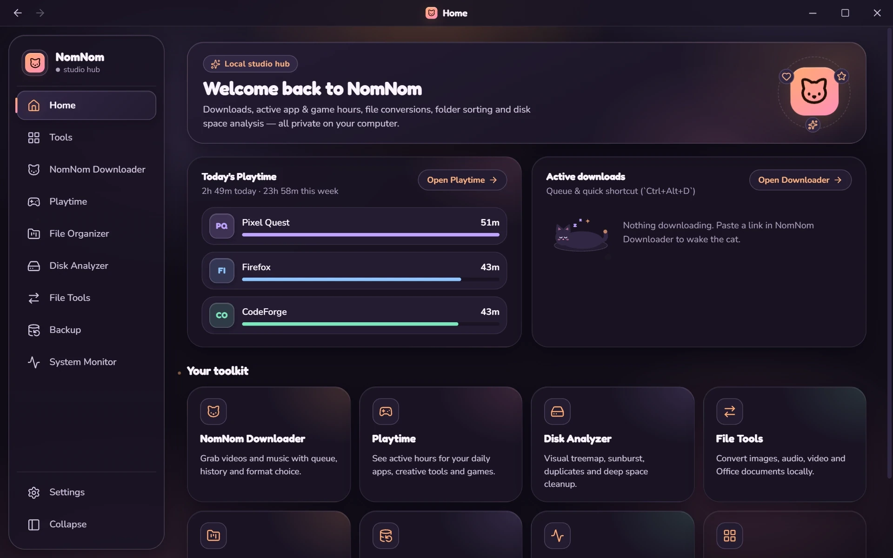
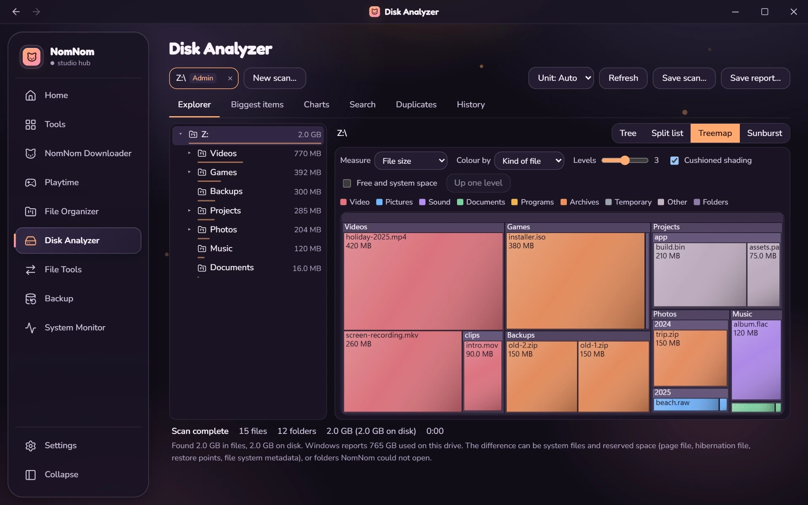
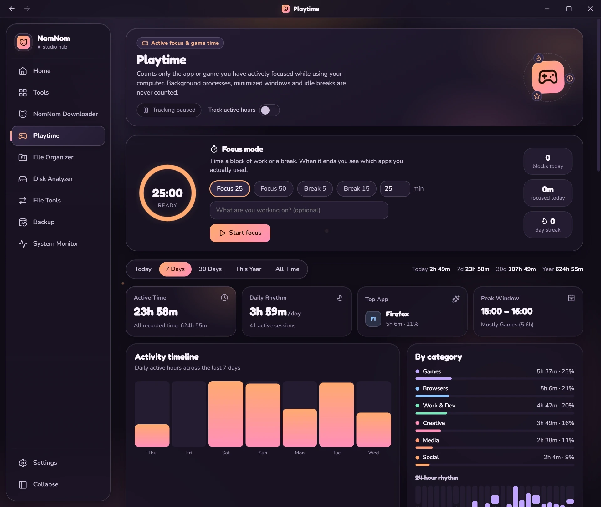
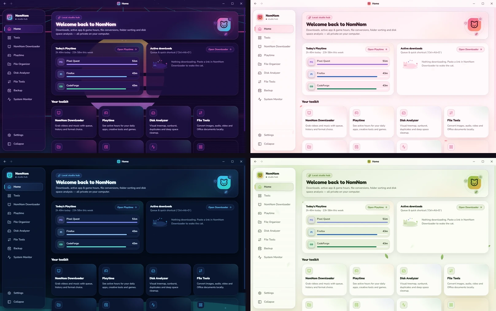

<div align="center">


<br>

[](https://github.com/Liveira/NomNom/releases/latest)
[](https://github.com/Liveira/NomNom/releases)
[](https://github.com/Liveira/NomNom/actions/workflows/ci.yml)
[](LICENSE)
[](https://github.com/Liveira/NomNom/stargazers)

**English** · [Português (Brasil)](README.pt-BR.md)

[**⬇️ Download**](#download) &nbsp;·&nbsp; [Features](#features) &nbsp;·&nbsp; [Browser extension](#extension) &nbsp;·&nbsp; [Privacy](#privacy) &nbsp;·&nbsp; [Build from source](#build) &nbsp;·&nbsp; [Contributing](CONTRIBUTING.md)

</div>

<br>

NomNom is a small desktop app that puts the everyday jobs you keep opening other programs for in one place: **download a video or a song**, **sort your Downloads folder**, **convert a file**, **find out what is eating your disk**, **back up a folder**, **see how long you really played that game**.

It runs on **Windows 11**, **Arch Linux** and **Debian / Ubuntu**. It is free, open source (MIT), has no account and no telemetry, and everything it does happens on your own computer.

<div align="center">

</div>

<br>

<a id="features"></a>
## ✨ What is inside

| | Tool | What it does |
|---|---|---|
| 📥 | **NomNom Downloader** | Paste a link, pick video or audio and a quality, done. Queue with pause and resume, history, duplicate check, subtitles, scheduled downloads and optional Firefox cookies for sites that need a sign-in. Powered by `yt-dlp` and `ffmpeg`. |
| ⚡ | **Quick download** | Press `Ctrl+Alt+D`. NomNom reads the link on your clipboard and opens a tiny popup. Enter starts the download. |
| 🗂️ | **File Organizer** | Sorts a folder (Downloads by default) into Videos, Audio, Images and Documents. You see a full preview first, system and software folders are refused, nothing is ever overwritten, and **every run can be undone**. Has an automatic mode for new downloads. |
| 🔄 | **File Tools** | Convert images, audio, video, text, Markdown, CSV / JSON / YAML / TOML, and Office documents (with LibreOffice) to PDF. Join PDFs or pull pages out. Your originals are only read, never changed. |
| 💽 | **Disk Analyzer** | See where your space went: tree, treemap, sunburst, charts by type, age, size and owner, biggest items, advanced search, **duplicate finder**, batch rename, saved scans, scheduled snapshots and reports (CSV, XLSX, PDF, HTML, JSON). Includes a **quick cleanup** for caches and temporary files. |
| 🎮 | **Playtime** | Counts only the app or game you actually have in focus. Idle time and background processes are not counted. Daily rhythm, categories, a six-month activity map, a **Focus mode** timer, and **goals**: a limit for a game or a target for an app, with alerts and a weekly report. |
| 🛟 | **Backup** | Copies chosen folders to a drive you pick, by hand or on a schedule. Dated versions, unchanged files take no extra space, old versions are pruned, and you can restore a file, a folder or a whole version. |
| 🈯 | **Translator** | Select text anywhere and press a shortcut: it is replaced by its translation, or shown in a small window next to the pointer. Uses your own DeepL key (the free one is enough). Can also **read text from the screen** (offline) and translate it. |
| 📋 | **Clipboard history** | Off until you turn it on. Text only, searchable, with pins and a number of days to keep. Copies a password manager marks as private are left out. |
| 📱 | **Phone transfer** | A QR code opens a page on your Wi-Fi: send photos and files from the phone to the computer, or download what you offer from the computer. No cloud, off by itself when idle. |
| 🚀 | **Startup apps** | See what opens with your computer and how much each one slowed it down (from Windows' own record). Turn programs off and on without uninstalling them. |
| 🔎 | **Search and launcher** | `Ctrl+K` inside NomNom, or `Alt+Space` from anywhere: find a tool, a program, a folder, a recent file or any file by name (through the system's own index, so NomNom keeps no list of its own), run one of your own actions, or type a sum and get the answer. |
| 🚀 | **My actions** | Programs, folders, links and commands of your own, with a global shortcut and values they ask for (a web search that asks what to look for). Commands run with an argument list, never through a shell. |
| 🔔 | **Reminders** | "in 20 minutes stretch", "tomorrow at 9 call mom", "every day at 18:30 drink water", in English, Portuguese or Spanish. A card appears even when the window is closed. |
| ✏️ | **Notes** | Short notes kept on this computer, with pins and search. A shortcut opens a blank one; "note buy milk" in the search saves one. |
| ⏱️ | **Time tools** | World clocks, a time-zone converter, a stopwatch, and a timer that rings with a card even when NomNom is closed. |
| 🧰 | **Text toolbox** | JSON, Base64, URLs, MD5 and SHA hashes, UUIDs, a regex tester that cannot freeze the window, timestamps, text differences, colours and contrast, and case conversion. All offline. |
| 🪄 | **Mini tools** | Keep any window on top, pick a colour from the screen (Windows), paste as plain text (Windows), and take the tracking off links. |
| 🪄 | **Folder rules** | "When a picture shows up in Downloads, make it WebP and move it to Pictures." NomNom waits for the file to finish arriving, never replaces or deletes anything, and every move can be put back. |
| 📸 | **Screenshots** | Press a shortcut, drag over part of the screen, and mark it up: arrows, boxes, a marker, numbered steps, text, and blocked-out parts for what must not be seen. Copy it or save it as a PNG. The picture is never uploaded or kept on disk unless you save it. (Windows) |
| 📝 | **Snippets** | Text you type again and again, saved under a name and pasted from the search box, with the date or the clipboard filled in. |
| 🎯 | **Game mode** | While a game is in front: notices held back, Windows' fastest power plan, and the background programs you choose asked to close. The plan is put back afterwards, even after a crash. (Windows) |
| 🔳 | **QR codes** | Make a code from text or a Wi-Fi network, or read one that is on your screen. |
| 🆚 | **Compare folders** | Put two folders side by side, see what is only in one, what differs and what is the same, and copy what you choose. A file that gets replaced is kept in a `.nomnom-replaced` folder, never lost. |
| 🗜️ | **ZIP files** | Pack files into a ZIP, look inside one, or unpack it into a new folder. Names that try to leave the folder are refused and nothing is overwritten. |
| 🎥 | **Screen recorder** | Record the screen or a part of it as MP4 or GIF with a shortcut. Uses `ffmpeg`, which NomNom downloads for you the first time. (Windows) |
| 🛣️ | **PATH editor** | See the folders Windows looks in for programs, find the repeated and missing ones, and tidy them. A copy of the old list is kept every time you save, so you can put it back. The computer-wide list is shown, never changed. (Windows) |
| 🕘 | **Notifications** | The notices NomNom showed in the last seven days, so one that went away unread can be found again. |
| 💾 | **Settings file** | Save your settings, actions and choices to a file and load them on another computer. Home also shows memory, disk, your next reminder and your latest note. |
| 📈 | **System Monitor** | CPU, memory, disks, network and the busiest programs, live, plus the graphics card and battery, and each disk's health (with a daily check that says so when one needs attention). It only looks, it never touches anything. |
| 🖱️ | **File manager menu** | Right-click files to convert them, or a folder to analyze its space. Works in Windows 11 Explorer, KDE Dolphin, GNOME Files and Cinnamon Nemo. |
| 🌐 | **Browser extension** | Download buttons on YouTube, X, Instagram, Reddit and over the video player on TikTok, Vimeo, Twitch and more. |
| 🎨 | **17 themes, 3 languages** | Each theme has its own moving background. English, Português (Brasil) and Español. Choose which tools show in the sidebar. |

<br>

<table>
<tr>
<td width="50%"></td>
<td width="50%"></td>
</tr>
<tr>
<td align="center"><sub><b>Disk Analyzer</b>: treemap, tree, sunburst, duplicates and reports</sub></td>
<td align="center"><sub><b>Playtime</b>: active hours per app, plus a Focus mode timer</sub></td>
</tr>
</table>

<div align="center">

<br><sub>Four of the 17 themes. The screenshots use sample data.</sub>
</div>

<br>

<a id="download"></a>
## ⬇️ Download

Grab the latest build from the **[Releases page](https://github.com/Liveira/NomNom/releases/latest)**.

| Your system | File | How |
|---|---|---|
| 🪟 **Windows 11** | `NOMNOM_<version>_x64-setup.exe` | Run it. It installs for your user only and needs no administrator rights. |
| 🐧 **Arch Linux** | `nomnom-<version>-1-x86_64.pkg.tar.zst` | `sudo pacman -U nomnom-*.pkg.tar.zst` |
| 🐧 **Debian / Ubuntu** | `NOMNOM_<version>_amd64.deb` | `sudo apt install ./NOMNOM_*_amd64.deb` |
| 🐧 **Any Linux** | `NOMNOM_<version>_amd64.AppImage` | `chmod +x` it and run it. |

Once installed, NomNom can check GitHub once a day for a new version and update itself. You can turn that off in **Settings → Updates**.

<details>
<summary><b>Verify your download</b></summary>

<br>

Every release includes `SHA256SUMS.txt`. Compare it with the file you downloaded.

```powershell
Get-FileHash .\NOMNOM_0.4.2_x64-setup.exe -Algorithm SHA256
```

```bash
sha256sum -c SHA256SUMS.txt --ignore-missing
```

The Windows installer is not signed with a paid code-signing certificate, so SmartScreen may ask you to confirm. The checksum, and the fact that the whole source is in this repository, are how you can check what you are running.

</details>

<details>
<summary><b>First steps</b></summary>

<br>

1. Open NomNom. A short first-run card asks what it may add to your system (right-click menu, start with the computer, browser connection). Everything is off until you say yes.
2. Choose which tools you want in the sidebar. The rest stay on the **Tools** page.
3. **Downloader**: NomNom offers to download `yt-dlp` (about 18 MB) and `ffmpeg` into its own folder. On Linux it uses the ones on your `PATH` when they exist.
4. Copy a video link and press `Ctrl+Alt+D`.

</details>

<br>

<a id="extension"></a>
## 🌐 Browser extension

The extension adds a download button on the page and sends the link to the desktop app. It talks to NomNom through Native Messaging and a per-user local pipe or socket, so nothing goes through the internet.

- **Firefox and LibreWolf**: open **Settings → Browser** in NomNom and connect.
- **Chrome and Edge**: download `nomnom-chrome-extension.zip` from the release, unzip it, open `chrome://extensions`, turn on *Developer mode* and choose *Load unpacked*.

<br>

<a id="privacy"></a>
## 🔒 Privacy and safety

- **No account. No telemetry. No ads.** The only network traffic is the downloads you ask for, the tools you ask NomNom to fetch, and the optional daily update check against this repository's releases.
- **Text you translate goes to DeepL, and only then.** Translating selected text sends just that text to DeepL with your own key. The key is stored locked to your Windows account. Everything else stays on your computer.
- **Playtime stays on your computer.** It records which app was in focus and for how long. Window titles and URLs are never saved.
- **Your files are handled carefully.** The organizer and converters never overwrite a file, always show what they are about to do, and keep an undo journal. Deleting goes through a plan and a confirmation, and the Trash or Recycle Bin is the default.
- **Updates are verified.** Downloads are checked against the published `SHA256SUMS.txt` and must come from this repository's releases.
- **Small footprint.** In the background NomNom uses about 6 MB and no web view at all. With the window open it gives unused memory back to the system, so Task Manager shows roughly 40 to 60 MB.

<details>
<summary><b>Where NomNom keeps its data</b></summary>

<br>

NomNom never writes outside your user profile unless you start a file operation.

| Purpose | Linux | Windows 11 |
|---|---|---|
| Data, history, snapshots, logs, managed tools | `~/.local/share/nomnom` | `%LOCALAPPDATA%\NOMNOM` |
| Settings | `~/.config/nomnom` | `%LOCALAPPDATA%\NOMNOM` |
| Cache and staged updates | `~/.cache/nomnom` | `%LOCALAPPDATA%\NOMNOM\cache` |
| Local IPC endpoint | `$XDG_RUNTIME_DIR/nomnom.sock` (`0600`) | `\\.\pipe\nomnom-<SID>` (per-user) |

</details>

<br>

<a id="build"></a>
## 🛠️ Build from source

You need Rust (stable), Node.js 20 or newer and the platform packages below.

```bash
git clone https://github.com/Liveira/NomNom.git
cd NomNom
npm install
npm run dev          # Vite + Tauri with hot reload
```

<details>
<summary><b>🪟 Windows 11</b></summary>

<br>

Rust `stable-x86_64-pc-windows-msvc`, Node.js 20+ and the Windows 10/11 SDK (only needed for the signed Explorer menu package). WebView2 ships with Windows 11.

```powershell
npm install
scripts\build-release.ps1                 # app, native host, Explorer package, Firefox add-on, NSIS installer
scripts\build-release.ps1 -SkipInstaller  # release binaries only
scripts\bench.ps1                         # memory, idle CPU and window ready time
```

</details>

<details>
<summary><b>🐧 Arch Linux</b></summary>

<br>

Notes for KDE Plasma, GNOME, Hyprland / Sway, Polkit agents and LibreWolf are in [packaging/arch/README.md](packaging/arch/README.md).

```bash
sudo pacman -S --needed base-devel rust nodejs npm pkgconf \
  webkit2gtk-4.1 gtk3 glib2 libayatana-appindicator hicolor-icon-theme

# optional runtime tools (NomNom can also download yt-dlp and ffmpeg itself)
sudo pacman -S --needed yt-dlp ffmpeg libreoffice-fresh polkit

./scripts/build-linux.sh --arch
sudo pacman -U dist/linux/nomnom-*.pkg.tar.zst
```

Or with `makepkg` directly: `cd packaging/arch && makepkg -si`.

</details>

<details>
<summary><b>🐧 Debian / Ubuntu</b></summary>

<br>

Built against Ubuntu 22.04 LTS, Ubuntu 24.04 LTS and Debian 12 or newer.

```bash
sudo apt update
sudo apt install -y build-essential pkg-config curl file patchelf \
  libwebkit2gtk-4.1-dev libgtk-3-dev libayatana-appindicator3-dev \
  librsvg2-dev libssl-dev

# optional runtime packages
sudo apt install -y ffmpeg libreoffice policykit-1

./scripts/build-linux.sh --deb
sudo apt install ./dist/linux/NOMNOM_*_amd64.deb

# or a self-contained AppImage
./scripts/build-linux.sh --appimage
```

</details>

<details>
<summary><b>🐧 Linux desktop notes</b></summary>

<br>

- **Wayland with an NVIDIA GPU**: NomNom sets `WEBKIT_DISABLE_DMABUF_RENDERER=1` for you when it detects this, to avoid a blank WebKitGTK window.
- **Scanning root-owned folders**: uses `pkexec` over a `0600` socket owned by your user. On tiling compositors (Hyprland, Sway) keep a Polkit agent running, such as `polkit-kde-agent`, `hyprpolkitagent` or `mate-polkit`.
- **Background mode**: `nomnom --background` keeps no web view alive, so idle memory stays low until you open the window or press the quick download shortcut.

</details>

<details>
<summary><b>✅ Checks and tests</b></summary>

<br>

```bash
cargo fmt --all --check
cargo clippy --workspace --all-targets -- -D warnings
cargo test --workspace
npm run check                          # svelte-check
npm test                               # Vitest: unit, contrast and UI text tests
npm test -w @nomnom/firefox-extension  # extension tests
```

Linux memory, CPU and start-up benchmark on a release build: `./scripts/build-linux.sh --skip-bundle && ./scripts/bench-linux.sh`

</details>

<details>
<summary><b>🧱 How the repository is laid out</b></summary>

<br>

| Path | What is there |
|---|---|
| `apps/desktop` | Svelte 5 + TypeScript interface and the Tauri v2 host (`src-tauri`) |
| `apps/firefox-extension` | Manifest V3 extension for Firefox, LibreWolf, Chrome and Edge, built from one source |
| `crates/nomnom-core` | Paths, settings, SQLite history, safe file moves, process groups |
| `crates/nomnom-downloads` | Download queue, `yt-dlp` runner, format selection, cookie discovery |
| `crates/nomnom-tools` | `yt-dlp` and `ffmpeg` discovery, SHA-256 verified installs, release updater |
| `crates/nomnom-converter` | Image, audio, video, document, structured text and PDF conversions |
| `crates/nomnom-organizer` | Preview-first organizer with an undo journal and system path guards |
| `crates/nomnom-storage` | Parallel disk scanner, duplicates, search, reports, Trash, elevation |
| `crates/nomnom-backup` | Versioned backups, restore and verification |
| `crates/nomnom-activity` | Focused-window tracking and idle detection for Playtime |
| `crates/nomnom-ipc` · `nomnom-native-host` | Native Messaging framing and the per-user pipe / socket to the browser |
| `crates/nomnom-linux` · `nomnom-win` · `nomnom-shell` | Autostart, browser registration and file manager menus per platform, including the Windows 11 `IExplorerCommand` DLL |
| `packaging` | Arch `PKGBUILD`, Debian and Freedesktop files, Windows sparse package manifest |
| `scripts` | Release and benchmark scripts |

The library crates never depend on Tauri. Only `apps/desktop/src-tauri` does.

</details>

<br>

## 🤝 Contributing

Bug reports, ideas and pull requests are welcome. The quickest ways to help:

- **Try it and tell me what broke.** Linux support is newer than Windows support, so reports from different desktops and distributions are especially useful.
- **Translate.** The app already speaks English, Português (Brasil) and Español. More languages fit the same catalog.
- **Pick an issue** labelled `good first issue`, or open one with your idea first.

Please read [CONTRIBUTING.md](CONTRIBUTING.md) before opening a pull request, and [SECURITY.md](SECURITY.md) for security problems.

If NomNom saved you some time, a ⭐ on the repository helps other people find it.

<br>

## 📄 License and credits

[MIT](LICENSE). `ffmpeg`, `yt-dlp` and LibreOffice are separate programs under their own licenses. NomNom uses the ones installed on your system, or downloads `yt-dlp` and `ffmpeg` on request, and never bundles them.

Icons are [Lucide](https://lucide.dev) (ISC). Fonts are [Fredoka](https://fonts.google.com/specimen/Fredoka) and [Nunito](https://fonts.google.com/specimen/Nunito) (SIL Open Font License). Full notices are in [THIRD-PARTY-NOTICES.md](THIRD-PARTY-NOTICES.md).

NomNom is not affiliated with YouTube, X, Instagram, Reddit, TikTok or any other site it can download from. Please respect the terms of the sites you use and the rights of the people who made what you download.
