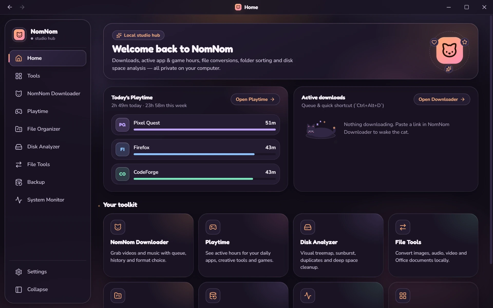
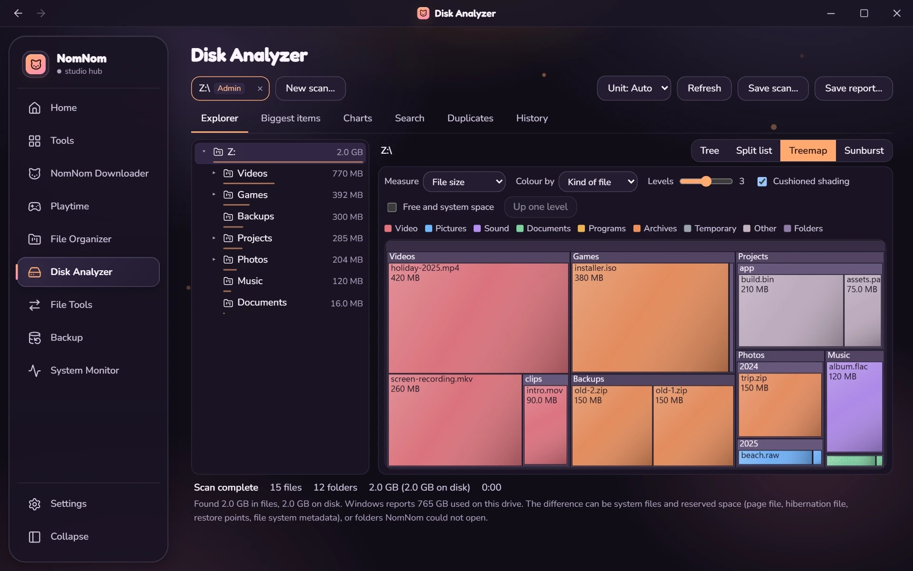
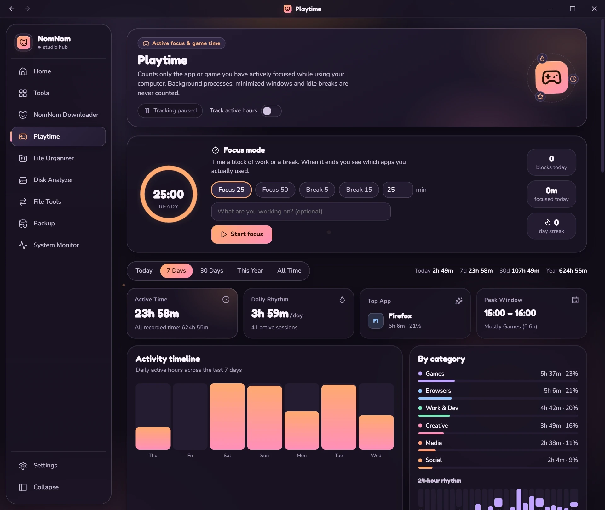
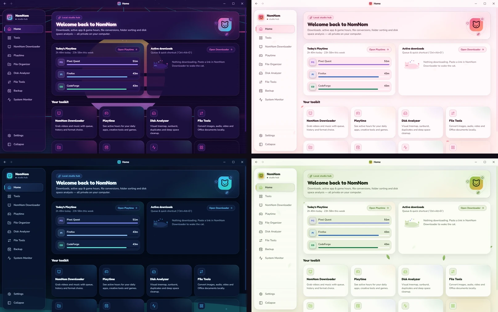

<div align="center">


<br>

[](https://github.com/Liveira/NomNom/releases/latest)
[](https://github.com/Liveira/NomNom/releases)
[](https://github.com/Liveira/NomNom/actions/workflows/ci.yml)
[](LICENSE)
[](https://github.com/Liveira/NomNom/stargazers)

[English](README.md) · **Português (Brasil)**

[**⬇️ Baixar**](#download) &nbsp;·&nbsp; [Recursos](#features) &nbsp;·&nbsp; [Extensão do navegador](#extension) &nbsp;·&nbsp; [Privacidade](#privacy) &nbsp;·&nbsp; [Compilar](#build) &nbsp;·&nbsp; [Contribuir](CONTRIBUTING.md)

</div>

<br>

O NomNom é um app de desktop pequeno que junta as tarefas do dia a dia pelas quais você sempre abre outros programas: **baixar um vídeo ou uma música**, **organizar a pasta Downloads**, **converter um arquivo**, **descobrir o que está comendo o seu disco**, **fazer backup de uma pasta** e **ver quanto tempo você realmente jogou aquele jogo**.

Funciona no **Windows 11**, no **Arch Linux** e no **Debian / Ubuntu**. É gratuito, de código aberto (MIT), sem conta e sem telemetria, e tudo o que ele faz acontece no seu próprio computador.

<div align="center">

</div>

<br>

<a id="features"></a>
## ✨ O que vem dentro

| | Ferramenta | O que faz |
|---|---|---|
| 📥 | **NomNom Downloader** | Cole um link, escolha vídeo ou áudio e a qualidade, pronto. Fila com pausar e retomar, histórico, aviso de duplicado, legendas, downloads agendados e cookies do Firefox (opcional) para sites que pedem login. Usa `yt-dlp` e `ffmpeg`. |
| ⚡ | **Download rápido** | Aperte `Ctrl+Alt+D`. O NomNom lê o link da sua área de transferência e abre um popup pequeno. Enter começa o download. |
| 🗂️ | **Organizador de arquivos** | Separa uma pasta (Downloads, por padrão) em Vídeos, Áudio, Imagens e Documentos. Você vê uma prévia completa antes, pastas do sistema e de programas são recusadas, nada é sobrescrito, e **toda execução pode ser desfeita**. Tem modo automático para downloads novos. |
| 🔄 | **Ferramentas de arquivo** | Converte imagens, áudio, vídeo, texto, Markdown, CSV / JSON / YAML / TOML e documentos do Office (com LibreOffice) para PDF. Junta PDFs ou extrai páginas. Os originais só são lidos, nunca alterados. |
| 💽 | **Analisador de disco** | Mostra para onde foi o espaço: árvore, treemap, sunburst, gráficos por tipo, idade, tamanho e dono, maiores itens, busca avançada, **localizador de duplicados**, renomear em lote, scans salvos, históricos agendados e relatórios (CSV, XLSX, PDF, HTML, JSON). Inclui uma **limpeza rápida** de caches e arquivos temporários. |
| 🎮 | **Playtime** | Conta só o app ou jogo que está em foco de verdade. Tempo parado e processos em segundo plano não entram. Ritmo diário, categorias, mapa de atividade de seis meses um **modo Foco** com cronômetro e **metas**: um limite para um jogo ou uma meta de uso para um app, com avisos e um relatório semanal. |
| 🛟 | **Backup** | Copia as pastas escolhidas para um disco que você indicar, na hora ou agendado. Versões com data, arquivos iguais não ocupam espaço extra, versões antigas são removidas e você restaura um arquivo, uma pasta ou uma versão inteira. |
| 🈯 | **Tradutor** | Selecione um texto em qualquer lugar e aperte um atalho: ele é trocado pela tradução, ou aparece numa janela pequena ao lado do mouse. Usa a sua própria chave do DeepL (a gratuita basta). Também **lê texto da tela** (offline) e traduz. |
| 📋 | **Histórico da área de transferência** | Desligado até você ligar. Só texto, com busca, itens fixados e um número de dias para guardar. Cópias que um gerenciador de senhas marca como privadas ficam de fora. |
| 📱 | **Transferência com o celular** | Um QR code abre uma página no seu Wi-Fi: envie fotos e arquivos do celular para o computador, ou baixe o que você oferecer do computador. Sem nuvem, e desliga sozinho quando ninguém usa. |
| 🚀 | **Apps de inicialização** | Veja o que abre com o computador e quanto cada um atrasou (pelo registro do próprio Windows). Desligue e ligue programas sem desinstalar. |
| 🔎 | **Busca e lançador** | `Ctrl+K` dentro do NomNom, ou `Alt+Espaço` de qualquer lugar: ache uma ferramenta, um programa, uma pasta ou um arquivo recente, rode uma ação sua, ou digite uma conta e veja a resposta. |
| 🚀 | **Minhas ações** | Programas, pastas, links e comandos seus, com atalho global e valores que eles perguntam (uma busca na web que pergunta o que procurar). Comandos rodam com uma lista de argumentos, nunca por um shell. |
| 🔔 | **Lembretes** | "em 20 minutos alongar", "amanhã às 9 ligar para a mãe", "todo dia às 18:30 beber água", em português, inglês ou espanhol. Um cartão aparece mesmo com a janela fechada. |
| ✏️ | **Notas** | Notas curtas guardadas neste computador, com fixar e busca. Um atalho abre uma em branco; "nota comprar leite" na busca salva uma. |
| ⏱️ | **Ferramentas de tempo** | Relógios mundiais, conversor de fuso horário, cronômetro e um temporizador que avisa com um cartão mesmo com o NomNom fechado. |
| 🧰 | **Caixa de ferramentas de texto** | JSON, Base64, URLs, hashes MD5 e SHA, UUIDs, um testador de regex que não trava a janela, timestamps, diferenças de texto, cores e contraste, e troca de maiúsculas. Tudo offline. |
| 🪄 | **Mini ferramentas** | Manter qualquer janela no topo, escolher uma cor da tela (Windows), colar como texto simples (Windows) e tirar o rastreio de links. |
| 🪄 | **Regras para pastas** | "Quando uma imagem aparecer em Downloads, transforme em WebP e mova para Imagens." O NomNom espera o arquivo terminar de chegar, nunca substitui nem apaga nada, e todo movimento pode ser desfeito. |
| 🕘 | **Notificações** | Os avisos que o NomNom mostrou nos últimos sete dias, para achar de novo um que sumiu sem ser lido. |
| 💾 | **Arquivo de configurações** | Salve suas configurações, ações e escolhas num arquivo e carregue em outro computador. O início também mostra memória, disco, seu próximo lembrete e sua última nota. |
| 📈 | **Monitor do sistema** | Processador, memória, discos, rede e os programas que mais usam, ao vivo. Só observa, nunca mexe em nada. |
| 🖱️ | **Menu do gerenciador de arquivos** | Clique com o botão direito em arquivos para convertê-los, ou em uma pasta para analisar o espaço. Funciona no Explorer do Windows 11, KDE Dolphin, GNOME Files e Cinnamon Nemo. |
| 🌐 | **Extensão do navegador** | Botões de download no YouTube, X, Instagram, Reddit e sobre o player no TikTok, Vimeo, Twitch e outros. |
| 🎨 | **17 temas, 3 idiomas** | Cada tema tem seu próprio fundo animado. Inglês, Português (Brasil) e Espanhol. Você escolhe quais ferramentas aparecem na barra lateral. |

<br>

<table>
<tr>
<td width="50%"></td>
<td width="50%"></td>
</tr>
<tr>
<td align="center"><sub><b>Analisador de disco</b>: treemap, árvore, sunburst, duplicados e relatórios</sub></td>
<td align="center"><sub><b>Playtime</b>: horas ativas por app, mais um cronômetro de Foco</sub></td>
</tr>
</table>

<div align="center">

<br><sub>Quatro dos 17 temas. As capturas de tela usam dados de exemplo.</sub>
</div>

<br>

<a id="download"></a>
## ⬇️ Baixar

Pegue a versão mais recente na **[página de Releases](https://github.com/Liveira/NomNom/releases/latest)**.

| Seu sistema | Arquivo | Como |
|---|---|---|
| 🪟 **Windows 11** | `NOMNOM_<versão>_x64-setup.exe` | Execute. Instala só para o seu usuário e não pede direitos de administrador. |
| 🐧 **Arch Linux** | `nomnom-<versão>-1-x86_64.pkg.tar.zst` | `sudo pacman -U nomnom-*.pkg.tar.zst` |
| 🐧 **Debian / Ubuntu** | `NOMNOM_<versão>_amd64.deb` | `sudo apt install ./NOMNOM_*_amd64.deb` |
| 🐧 **Qualquer Linux** | `NOMNOM_<versão>_amd64.AppImage` | Dê `chmod +x` e execute. |

Depois de instalado, o NomNom pode olhar o GitHub uma vez por dia atrás de uma versão nova e se atualizar sozinho. Dá para desligar em **Configurações → Atualizações**.

<details>
<summary><b>Confira o arquivo baixado</b></summary>

<br>

Toda versão publicada inclui o `SHA256SUMS.txt`. Compare com o arquivo que você baixou.

```powershell
Get-FileHash .\NOMNOM_0.4.2_x64-setup.exe -Algorithm SHA256
```

```bash
sha256sum -c SHA256SUMS.txt --ignore-missing
```

O instalador do Windows não é assinado com um certificado pago de assinatura de código, então o SmartScreen pode pedir confirmação. O checksum, e o fato de todo o código-fonte estar neste repositório, são a forma de conferir o que você está executando.

</details>

<details>
<summary><b>Primeiros passos</b></summary>

<br>

1. Abra o NomNom. Um cartão rápido de primeiro uso pergunta o que ele pode adicionar ao seu sistema (menu do botão direito, iniciar com o computador, conexão com o navegador). Tudo fica desligado até você aceitar.
2. Escolha quais ferramentas quer na barra lateral. As outras ficam na página **Ferramentas**.
3. **Downloader**: o NomNom oferece baixar o `yt-dlp` (cerca de 18 MB) e o `ffmpeg` para a pasta dele. No Linux ele usa os que já estão no seu `PATH`.
4. Copie o link de um vídeo e aperte `Ctrl+Alt+D`.

</details>

<br>

<a id="extension"></a>
## 🌐 Extensão do navegador

A extensão adiciona um botão de download na página e envia o link para o app. Ela conversa com o NomNom por Native Messaging e por um pipe ou socket local do seu usuário, então nada passa pela internet.

- **Firefox e LibreWolf**: abra **Configurações → Navegador** no NomNom e conecte.
- **Chrome e Edge**: baixe o `nomnom-chrome-extension.zip` da release, descompacte, abra `chrome://extensions`, ative o *Modo do desenvolvedor* e escolha *Carregar sem compactação*.

<br>

<a id="privacy"></a>
## 🔒 Privacidade e segurança

- **Sem conta. Sem telemetria. Sem anúncios.** O único tráfego de rede são os downloads que você pede, as ferramentas que você pede para o NomNom buscar e a verificação diária (opcional) de atualização nas releases deste repositório.
- **O texto que você traduz vai para o DeepL, e só nesse caso.** Traduzir um texto selecionado envia apenas esse texto ao DeepL com a sua própria chave. A chave fica guardada protegida pela sua conta do Windows. Todo o resto fica no seu computador.
- **O Playtime fica no seu computador.** Ele registra qual app estava em foco e por quanto tempo. Títulos de janela e URLs nunca são salvos.
- **Seus arquivos são tratados com cuidado.** O organizador e os conversores nunca sobrescrevem um arquivo, sempre mostram o que vão fazer e mantêm um diário para desfazer. Apagar passa por um plano e uma confirmação, e a Lixeira é o padrão.
- **Atualizações são verificadas.** Os downloads são conferidos com o `SHA256SUMS.txt` publicado e precisam vir das releases deste repositório.
- **Leve.** Em segundo plano o NomNom usa cerca de 6 MB e nenhuma web view. Com a janela aberta, ele devolve a memória sem uso ao sistema, e o Gerenciador de Tarefas mostra uns 40 a 60 MB.

<details>
<summary><b>Onde o NomNom guarda os dados</b></summary>

<br>

O NomNom nunca escreve fora do seu perfil de usuário, a não ser que você inicie uma operação com arquivos.

| Finalidade | Linux | Windows 11 |
|---|---|---|
| Dados, histórico, snapshots, logs, ferramentas gerenciadas | `~/.local/share/nomnom` | `%LOCALAPPDATA%\NOMNOM` |
| Configurações | `~/.config/nomnom` | `%LOCALAPPDATA%\NOMNOM` |
| Cache e atualizações baixadas | `~/.cache/nomnom` | `%LOCALAPPDATA%\NOMNOM\cache` |
| Canal local (IPC) | `$XDG_RUNTIME_DIR/nomnom.sock` (`0600`) | `\\.\pipe\nomnom-<SID>` (por usuário) |

</details>

<br>

<a id="build"></a>
## 🛠️ Compilar a partir do código

Você precisa de Rust (stable), Node.js 20 ou mais novo e dos pacotes da sua plataforma abaixo.

```bash
git clone https://github.com/Liveira/NomNom.git
cd NomNom
npm install
npm run dev          # Vite + Tauri com hot reload
```

<details>
<summary><b>🪟 Windows 11</b></summary>

<br>

Rust `stable-x86_64-pc-windows-msvc`, Node.js 20+ e o SDK do Windows 10/11 (só necessário para o pacote assinado do menu do Explorer). O WebView2 já vem no Windows 11.

```powershell
npm install
scripts\build-release.ps1                 # app, native host, pacote do Explorer, add-on do Firefox, instalador NSIS
scripts\build-release.ps1 -SkipInstaller  # só os binários de release
scripts\bench.ps1                         # memória, CPU parada e tempo até a janela aparecer
```

</details>

<details>
<summary><b>🐧 Arch Linux</b></summary>

<br>

Notas sobre KDE Plasma, GNOME, Hyprland / Sway, agentes Polkit e LibreWolf estão em [packaging/arch/README.md](packaging/arch/README.md).

```bash
sudo pacman -S --needed base-devel rust nodejs npm pkgconf \
  webkit2gtk-4.1 gtk3 glib2 libayatana-appindicator hicolor-icon-theme

# ferramentas opcionais (o NomNom também baixa o yt-dlp e o ffmpeg sozinho)
sudo pacman -S --needed yt-dlp ffmpeg libreoffice-fresh polkit

./scripts/build-linux.sh --arch
sudo pacman -U dist/linux/nomnom-*.pkg.tar.zst
```

Ou direto com o `makepkg`: `cd packaging/arch && makepkg -si`.

</details>

<details>
<summary><b>🐧 Debian / Ubuntu</b></summary>

<br>

Compilado no Ubuntu 22.04 LTS, Ubuntu 24.04 LTS e Debian 12 ou mais novo.

```bash
sudo apt update
sudo apt install -y build-essential pkg-config curl file patchelf \
  libwebkit2gtk-4.1-dev libgtk-3-dev libayatana-appindicator3-dev \
  librsvg2-dev libssl-dev

# pacotes opcionais
sudo apt install -y ffmpeg libreoffice policykit-1

./scripts/build-linux.sh --deb
sudo apt install ./dist/linux/NOMNOM_*_amd64.deb

# ou um AppImage independente
./scripts/build-linux.sh --appimage
```

</details>

<details>
<summary><b>🐧 Notas sobre o desktop Linux</b></summary>

<br>

- **Wayland com GPU NVIDIA**: o NomNom define `WEBKIT_DISABLE_DMABUF_RENDERER=1` sozinho ao detectar isso, para evitar uma janela em branco do WebKitGTK.
- **Escanear pastas do root**: usa `pkexec` sobre um socket `0600` do seu usuário. Em compositores tiling (Hyprland, Sway) mantenha um agente Polkit rodando, como `polkit-kde-agent`, `hyprpolkitagent` ou `mate-polkit`.
- **Modo em segundo plano**: `nomnom --background` não mantém nenhuma web view viva, então a memória fica baixa até você abrir a janela ou usar o atalho de download rápido.

</details>

<details>
<summary><b>✅ Verificações e testes</b></summary>

<br>

```bash
cargo fmt --all --check
cargo clippy --workspace --all-targets -- -D warnings
cargo test --workspace
npm run check                          # svelte-check
npm test                               # Vitest: unitários, contraste e textos da interface
npm test -w @nomnom/firefox-extension  # testes da extensão
```

Benchmark de memória, CPU e inicialização no Linux, em build de release: `./scripts/build-linux.sh --skip-bundle && ./scripts/bench-linux.sh`

</details>

<details>
<summary><b>🧱 Como o repositório é organizado</b></summary>

<br>

| Caminho | O que tem |
|---|---|
| `apps/desktop` | Interface em Svelte 5 + TypeScript e o host Tauri v2 (`src-tauri`) |
| `apps/firefox-extension` | Extensão Manifest V3 para Firefox, LibreWolf, Chrome e Edge, gerada de uma única fonte |
| `crates/nomnom-core` | Caminhos, configurações, histórico em SQLite, movimentação segura de arquivos, grupos de processos |
| `crates/nomnom-downloads` | Fila de downloads, execução do `yt-dlp`, escolha de formato, descoberta de cookies |
| `crates/nomnom-tools` | Descoberta do `yt-dlp` e `ffmpeg`, instalação verificada por SHA-256, atualizador por releases |
| `crates/nomnom-converter` | Conversões de imagem, áudio, vídeo, documentos, texto estruturado e PDF |
| `crates/nomnom-organizer` | Organizador com prévia, diário para desfazer e proteção de pastas do sistema |
| `crates/nomnom-storage` | Scanner de disco paralelo, duplicados, busca, relatórios, Lixeira, elevação |
| `crates/nomnom-backup` | Backups versionados, restauração e verificação |
| `crates/nomnom-activity` | Janela em foco e detecção de inatividade para o Playtime |
| `crates/nomnom-ipc` · `nomnom-native-host` | Protocolo Native Messaging e o pipe / socket por usuário até o navegador |
| `crates/nomnom-linux` · `nomnom-win` · `nomnom-shell` | Início automático, registro no navegador e menus do gerenciador de arquivos por plataforma, incluindo a DLL `IExplorerCommand` do Windows 11 |
| `packaging` | `PKGBUILD` do Arch, arquivos Debian e Freedesktop, manifesto do pacote sparse do Windows |
| `scripts` | Scripts de release e benchmark |

As crates de biblioteca nunca dependem do Tauri. Só o `apps/desktop/src-tauri` depende.

</details>

<br>

## 🤝 Contribuindo

Relatos de bugs, ideias e pull requests são bem-vindos. As formas mais rápidas de ajudar:

- **Teste e conte o que quebrou.** O suporte ao Linux é mais novo que o do Windows, então relatos de outros desktops e distribuições ajudam muito.
- **Traduza.** O app já fala inglês, português (Brasil) e espanhol. Outros idiomas cabem no mesmo catálogo.
- **Pegue uma issue** com o rótulo `good first issue`, ou abra uma com a sua ideia antes.

Leia o [CONTRIBUTING.md](CONTRIBUTING.md) antes de abrir um pull request, e o [SECURITY.md](SECURITY.md) para problemas de segurança.

Se o NomNom economizou o seu tempo, uma ⭐ no repositório ajuda outras pessoas a encontrarem.

<br>

## 📄 Licença e créditos

[MIT](LICENSE). `ffmpeg`, `yt-dlp` e LibreOffice são programas separados, com licenças próprias. O NomNom usa os que estão instalados no seu sistema, ou baixa o `yt-dlp` e o `ffmpeg` sob pedido, e nunca os embute.

Os ícones são do [Lucide](https://lucide.dev) (ISC). As fontes são [Fredoka](https://fonts.google.com/specimen/Fredoka) e [Nunito](https://fonts.google.com/specimen/Nunito) (SIL Open Font License). Os avisos completos estão em [THIRD-PARTY-NOTICES.md](THIRD-PARTY-NOTICES.md).

O NomNom não tem ligação com YouTube, X, Instagram, Reddit, TikTok nem com qualquer outro site de onde ele possa baixar. Respeite os termos dos sites que usa e os direitos de quem fez o que você baixa.
